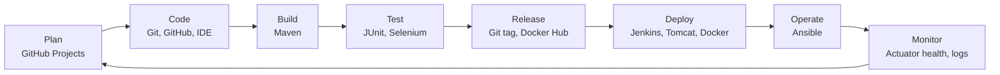
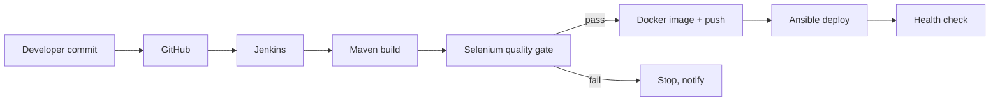

# Task 2: Agile Planning and DevOps Workflow

## 1. User Stories and Acceptance Criteria
| ID | User Story | Acceptance Criteria |
|---|---|---|
| US-01 | As an employee, I want to log in so that I see only my claims. | Valid credentials open the dashboard; invalid show an error; role decides menu. |
| US-02 | As an employee, I want to submit a claim with destination, purpose, amount, date and receipt so that my manager can review it. | All fields present; claim saved with status SUBMITTED; confirmation shown. |
| US-03 | As the system, I want to validate claims so that bad data is rejected. | Amount > 0; travel date not in future; receipt is PDF/JPG/PNG and <= 2 MB; errors shown next to fields. |
| US-04 | As an employee, I want to see all my claims and their status so that I know where they stand. | "My Claims" lists claims with status and reviewer comment. |
| US-05 | As a reviewer, I want a list of pending claims so that I can act on them. | Only SUBMITTED claims appear, newest first. |
| US-06 | As a reviewer, I want to approve a claim so that the employee is reimbursed. | Status becomes APPROVED; optional comment saved. |
| US-07 | As a reviewer, I want to reject a claim with a reason so that the employee can correct it. | Comment mandatory; status becomes REJECTED. |
| US-08 | As a reviewer, I want to see claim details and receipt before deciding. | Detail page shows all fields and receipt link. |
| US-09 | As a developer, I want automated build and tests so that defects are caught early. | Every commit triggers Jenkins build and Selenium tests. |
| US-10 | As an operator, I want one-command provisioning so that servers are repeatable. | Ansible playbook is idempotent and health check passes. |

## 2. Product Backlog
| ID | Item | Priority | Estimate (pts) | Task # |
|---|---|---|---|---|
| B-01 | Project skeleton and setup | High | 2 | 3 |
| B-02 | Repository, README, templates | High | 2 | 4 |
| B-03 | Claim entity, form, submission (US-02) | High | 5 | 5 |
| B-04 | Validation (US-03) | High | 3 | 6 |
| B-05 | Login and roles (US-01) | Medium | 3 | 6 |
| B-06 | Reviewer list and detail (US-05, US-08) | High | 3 | 6 |
| B-07 | Approve/reject (US-06, US-07) | High | 3 | 6 |
| B-08 | My Claims tracking (US-04) | High | 2 | 6 |
| B-09 | Jenkins CI job | High | 3 | 7 |
| B-10 | Jenkinsfile and Tomcat deploy | High | 5 | 8 |
| B-11 | Selenium tests | High | 5 | 9 |
| B-12 | Tests in Jenkins (quality gate) | High | 3 | 10 |
| B-13 | Dockerfile and lifecycle | High | 3 | 11 |
| B-14 | Jenkins-Docker CD | High | 5 | 12 |
| B-15 | Ansible playbook | High | 5 | 13 |
| B-16 | Provisioning, idempotency, rollback | High | 5 | 14 |
| B-17 | Final report, demo, viva | High | 5 | 15 |

## 3. 15-Task Kanban / Sprint Plan
Board columns: **To Do | In Progress | In Review | Done** (GitHub Projects).

| Sprint | Weeks | Tasks | Sprint Goal |
|---|---|---|---|
| Sprint 1 | 1-3 | 1-6 | Planned, versioned, working MVP |
| Sprint 2 | 4-6 | 7-12 | CI/CD with tests and Docker |
| Sprint 3 | 7-9 | 13-15 | Provisioning, reliability, final release |

Initial board state: Tasks 1-3 In Progress, Tasks 4-15 To Do.

## 4. Definition of Done
A task is Done only when:
- [ ] Code or document committed to a feature branch with a meaningful message
- [ ] Pull request reviewed and merged to `develop`
- [ ] Build passes (`mvn clean package`)
- [ ] Unit/Selenium tests pass (from Task 9 onward)
- [ ] Deployed to the target environment (from Task 8 onward)
- [ ] Documentation updated in `docs/`
- [ ] Evidence (screenshot/log) captured
- [ ] Kanban card moved to Done

## 5. DevOps Lifecycle Workflow

### Commit-to-production flow

