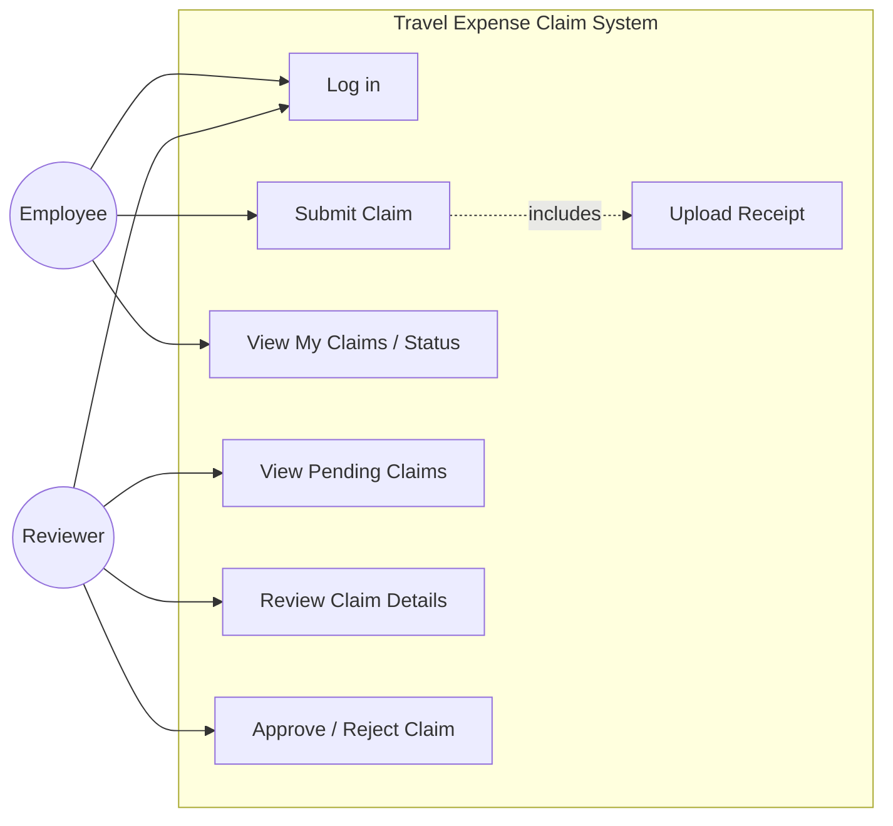
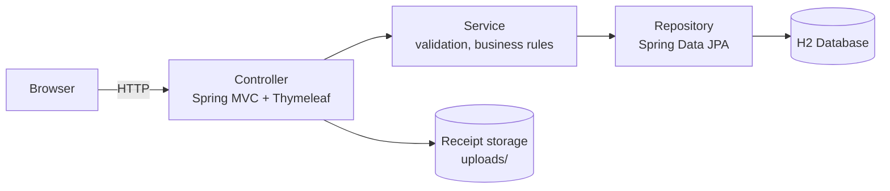
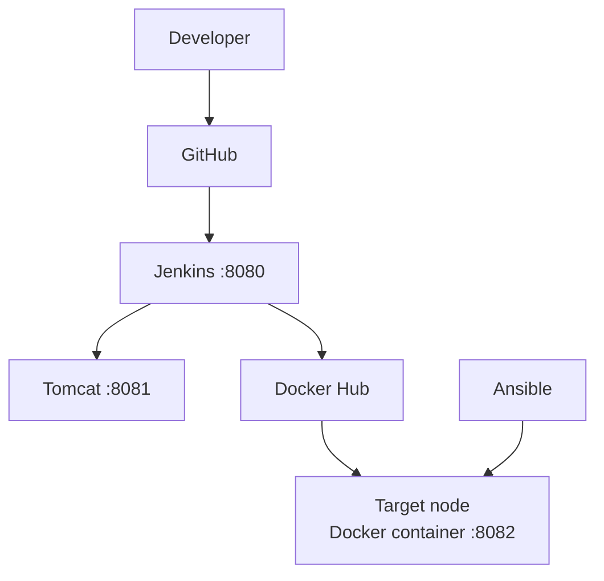
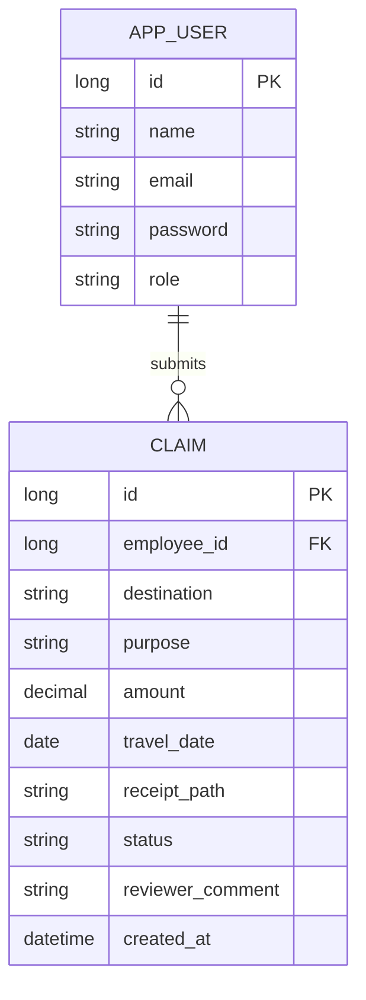

# Task 3: Requirements, Architecture and Technology Setup

## 1. SRS Summary

### Purpose
Web application for submitting, reviewing and tracking travel expense claims.

### Functional Requirements
| ID | Requirement |
|---|---|
| FR-01 | Users log in with a role: EMPLOYEE or REVIEWER. |
| FR-02 | Employee submits a claim (destination, purpose, amount, travel date, receipt). |
| FR-03 | System validates amount > 0, date not in future, receipt type PDF/JPG/PNG and size <= 2 MB. |
| FR-04 | Employee views own claims with status and reviewer comment. |
| FR-05 | Reviewer views the list of SUBMITTED claims. |
| FR-06 | Reviewer opens claim details and receipt. |
| FR-07 | Reviewer approves or rejects with a comment (mandatory on reject). |
| FR-08 | Status values: SUBMITTED, APPROVED, REJECTED. |

### Non-Functional Requirements
| ID | Requirement |
|---|---|
| NFR-01 | Usability: a claim can be submitted in under 2 minutes. |
| NFR-02 | Performance: pages respond within 2 seconds under light load. |
| NFR-03 | Security: server-side validation, role-based access to review pages, passwords not shown in logs. |
| NFR-04 | Portability: runs identically on Tomcat and in Docker. |
| NFR-05 | Maintainability: layered code, automated tests, documented pipeline. |
| NFR-06 | Availability: health endpoint at `/actuator/health`. |

### Assumptions
Single node, H2 database (file mode for persistence), no external services.

## 2. Use-Case Diagram

## 3. Architecture Diagram

### Deployment view

### Technology Stack
| Layer | Choice |
|---|---|
| Language / framework | Java 17, Spring Boot 3.x |
| Build | Maven |
| UI | Thymeleaf |
| Database | H2 |
| Web server | Tomcat (8081) |
| CI/CD | Jenkins (8080) |
| Testing | JUnit 5, Selenium WebDriver |
| Containers | Docker, Docker Hub |
| Config mgmt | Ansible |

## 4. Data Model

## 5. Route / API List
| Method | Path | Role | Purpose |
|---|---|---|---|
| GET | `/` | Any | Home page |
| GET/POST | `/login`, `/logout` | Any | Authentication |
| GET | `/claims` | Employee | My Claims list |
| GET | `/claims/new` | Employee | Claim form |
| POST | `/claims` | Employee | Submit claim |
| GET | `/claims/{id}` | Employee/Reviewer | Claim details |
| GET | `/review` | Reviewer | Pending claims |
| POST | `/review/{id}/approve` | Reviewer | Approve |
| POST | `/review/{id}/reject` | Reviewer | Reject (comment required) |
| GET | `/actuator/health` | Any | Health check |

## 6. Local Setup
See `docs/00-local-setup.md`. Working skeleton: home page at http://localhost:8082.
