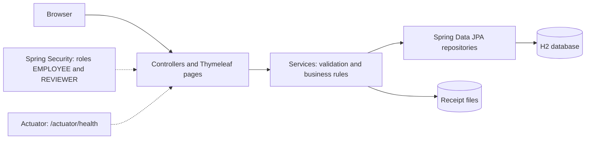
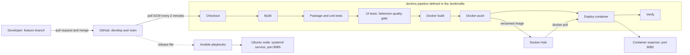

# Final Architecture

## Application

- Employees submit claims with a receipt, and see their own claims with status and reviewer comment
- Reviewers see pending claims, open the receipt and approve or reject with a comment
- Data and receipts are validated on the server

## Delivery pipeline

A failed stage stops the pipeline. A failed UI test therefore means that no image is built and nothing is deployed.

## Environments and ports

| Component | Port | Purpose |
|---|---|---|
| Jenkins | 8080 | CI/CD server |
| Tomcat | 8081 | Optional WAR deployment (Task 8) |
| Application, local run and Docker container | 8082 | Application |
| Application started by the UI test stage | 8083 | Selenium tests, temporary |
| Ansible node (Ubuntu in WSL2) | 8085 | Application as a systemd service |

## Tools

| Area | Tool |
|---|---|
| Language and framework | Java 17, Spring Boot 3.2.5, Thymeleaf, Spring Security, Spring Data JPA |
| Database | H2 |
| Build | Maven |
| Version control | Git and GitHub, branches main, develop, feature and bugfix, pull requests, tags |
| CI/CD | Jenkins, Jenkinsfile |
| Tests | JUnit 5, Selenium WebDriver with Chrome |
| Containers | Docker, Docker Hub |
| Configuration management | Ansible, systemd |

## Release layout on the Ansible node
- /opt/expense/releases/<version>/app.war: one folder per release
- /opt/expense/current: link to the active release (used for updates and rollback)
- /etc/expense/expense.env: settings, /var/lib/expense: data, /var/log/expense: log